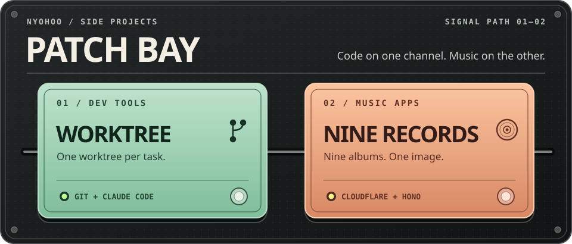

# Yuji Fujiwara / nyohoo

I build web backends with Rails. On the side, I make tools for picking up where I left off, and apps for sharing the records I love.

## Projects

- **[Git Worktree Manager](https://github.com/nyohoo/git-worktree-manager)** — A tool for running Claude Code tasks in parallel, each in its own Git worktree.
- **[MyFavoriteAlbums](https://github.com/nyohoo/my_favorite_albums)** — Pick nine favorite albums and share them as one image. Built with Cloudflare Workers and Hono.
